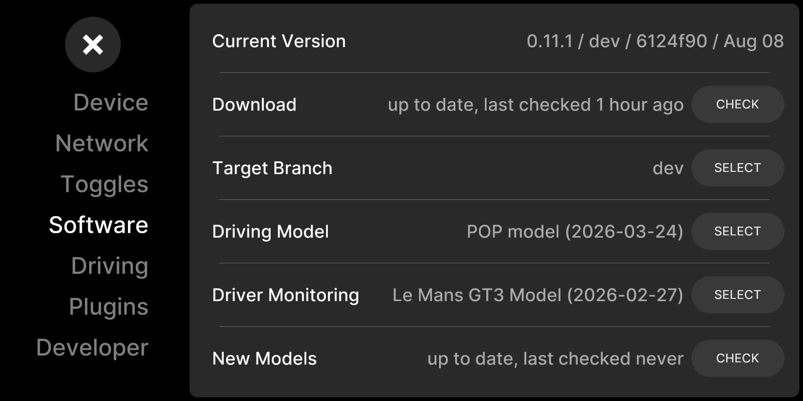

# Model Selector

Browse, download, and switch between openpilot driving and driver-monitoring
models.

This version targets **catpilot 0.11.2 onwards**. openpilot 0.11.2 loads a
single combined driving model (`driving_supercombo.onnx`), so driving models
saved on 0.11.1, which were split into separate vision and policy files, are not
loadable here. They stay on disk but are hidden from **SELECT**, so the panel
cannot delete them either; remove them over ssh (they live under
`/data/models/driving/`).

## What it does

openpilot ships with one driving model and one driver-monitoring (DM) model.
This plugin lets you keep several of each on the device and pick which one is
active:

- **Driving model** — the neural net that actually steers and paces the car
  (lateral and longitudinal). Swapping it is the one that changes how the car
  drives.
- **Driver-monitoring model** — swapping it changes how driver monitoring behaves.

It can also download models that comma has published and that have been test
driven on your openpilot version, ready to switch to whenever you want.

## How to use it

Everything lives in **Settings → Software**. The plugin adds three rows:

- **Driving Model** — shows the active driving model; tap **SELECT** to see
  every driving model installed on the device and switch, or delete one you no
  longer want.
- **Driver Monitoring** — same, for the DM model.
- **Tested Models** — tap **CHECK**. It lists the models that have been test
  driven on your openpilot version and aren't installed yet, and lets you
  download one. The list ships with the plugin, so it updates when catpilot
  does. The row shows status (`checking…`, `N available`, `downloading`,
  `download complete`, `up to date`).

When you activate a model, the plugin stages it and asks you to **Reboot** —
the swap only takes effect after the reboot. If you cancel the reboot prompt,
it puts the previous model back, so nothing changes until you actually reboot.

## Things to know

- **A driving-model swap changes how the car drives.** Treat a new driving
  model like any other tuning change: try it somewhere safe first.
- **It takes effect after a reboot**, not live while driving.
- **First drive after a swap is slow to start.** The first time a given model
  runs on this device, openpilot has to compile it for the hardware (roughly a
  minute on a comma three). After that it's cached — switching back to a model
  you've used before is instant.
- **You can't delete the model that's currently active.** Switch to another
  one first.
- **Only tested models can be selected.** Every model offered here has been
  test driven on your openpilot version, along with the model your release
  ships. Anything else on the device is shown as *untested* and can't be
  activated.
- **"active file differs, re-activate."** If the Software row shows this after
  the model name, the model file openpilot will actually load is not the one you
  selected (an update or a git reset put another file back). Select the model and
  tap **Activate** again, then reboot.
- **After a catpilot update, the model your release ships is what runs.** An
  update puts the release's own model file back. If the panel cannot check the
  model you had selected against that file (a model saved on 0.11.1, for
  example), it shows the release's model after the first boot. A model it can
  check shows *active file differs, re-activate* instead: activate it again and
  reboot to bring it back. A model that has not been tested on the new version
  is flagged *untested*, and the panel offers to switch you to the release's
  model.

## Turning it on and off

It's a standard plugin: enable or disable it under **Settings → Plugins**.
With it off, the extra rows in the Software panel simply don't appear and the
active model is whatever was last selected.

## More

Where models are stored, how downloads and the ONNX→PKL cache work, and the
hooks it uses are in [DESIGN.md](DESIGN.md).
